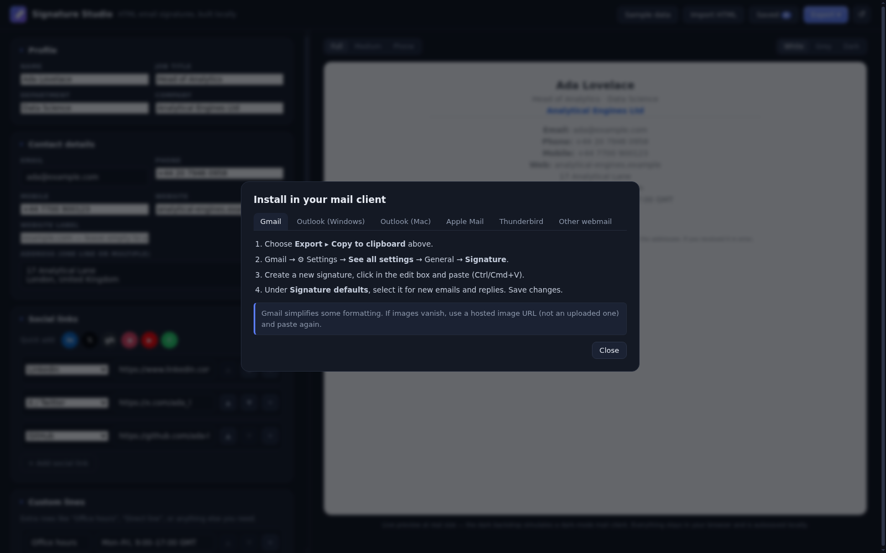

# Signature Studio

A web-based tool for **creating and editing HTML email signatures** — in your
browser, with your data staying on your machine. No account, no backend, no
tracking.


## Features

- **5 layout templates** — Classic, Centered, Compact, Banner, Minimal —
  switchable live as you type.
- **Profile & contact details** — name, title, department, company, email,
  phone, mobile, website, multi-line address.
- **Social links** — LinkedIn, X, Facebook, Instagram, GitHub, YouTube,
  TikTok, Mastodon, Bluesky, WhatsApp, Telegram, Signal, Xing, Pinterest, plus
  custom links with your own glyph and colour. Quick-add chips, reorder,
  remove. Typing just a username ("janedoe") is enough — full URLs are built
  for you.
- **Custom lines** — office hours, direct line, anything else you need.
- **Design controls** — accent/text/divider colours, 4 font stacks, base font
  size, logo (URL or upload) with width, banner image, divider, legal /
  disclaimer footer, social style (icons / icons + labels / text links).
- **Dark-mode friendly toggle** — adds `prefers-color-scheme` overrides for
  Gmail and Apple Mail dark mode, with a dark preview backdrop to check the
  result.
- **Live preview** at real size — full / medium / phone widths, white / grey /
  dark backgrounds.
- **Import existing signatures** — paste HTML you already use; name, contact
  details, links, logo and legal lines are recovered (best-effort).
- **Export** — copy rich HTML to the clipboard, download a `.html` file, plain
  text version for text-only clients, and step-by-step install guides for
  Gmail, Outlook (Windows/Mac), Apple Mail, Thunderbird and other webmail.
- **Autosave + saved signatures** — your draft persists locally; save named
  snapshots and switch between them.
- **Privacy-first** — everything runs in `localStorage`. Nothing is uploaded.




## The output is built for email clients

Generated signatures use table-based layout with **every style inlined** — no
`<style>` blocks, no classes, no external CSS — so they render consistently in
Outlook desktop (Word engine), Gmail, Apple Mail and Thunderbird. Social
"icons" are text glyph chips rather than images, so nothing is blocked and
nothing needs hosting. See the [client compatibility notes](#compatibility)
below.

## Quick start

It's a static site — no build step, no dependencies.

**Option A — just open it**

```sh
python3 -m http.server 8137
# open http://localhost:8137
```

(Opening `index.html` directly from disk also works.)

**Option B — Docker**

```sh
docker compose up --build
# open http://localhost:8080
```

or

```sh
podman build -t signature-studio .
podman run -p 8080:80 signature-studio
```

**Option C — any static host** (nginx, Caddy, Forgejo Pages, …) — serve the
repository root.

## Using the app

1. **Build** your signature in the left panel — or click *Sample data* to see
   it filled in.
2. Watch the **live preview** on the right; use the width and background
   toggles to sanity-check it.
3. **Export ▸ Copy to clipboard**, then paste into your mail client (the
   *Install in your mail client…* guide covers Gmail, Outlook, Apple Mail and
   Thunderbird step by step).
4. Save named variants in the **Saved** panel.

### Images

Use hosted image URLs (your website, a CDN) for logo/banner. Uploading embeds
the image as a data URI, which many mail clients strip — the app warns you
about this.

## Compatibility

| Client | Support | Notes |
| --- | --- | --- |
| Outlook for Windows (desktop) | ✅ built for it | Table layout + inline styles; paste with "Keep Source Formatting" |
| Outlook for Mac / Outlook web | ✅ | |
| Gmail (web + mobile) | ✅ | Optional dark-mode toggle for dark theme |
| Apple Mail (macOS / iOS) | ✅ | Dark-mode toggle recommended |
| Thunderbird | ✅ | Use HTML signature mode |
| Other rich-text webmail (Proton, Fastmail, …) | ✅ | |

Keep signatures ≤ 600 px wide, prefer hosted images, and send yourself a test
email in the client your recipients actually use.

## Project layout

```
index.html              app shell (editor, preview, modals)
assets/styles.css       app UI — never part of generated output
assets/js/state.js      data model, defaults, sample data
assets/js/socials.js    network catalogue (glyph, colour, URL prefix)
assets/js/templates.js  signature renderer: state → HTML document
assets/js/import.js     best-effort HTML signature importer
assets/js/export.js     clipboard / download / plain-text export
assets/js/storage.js    localStorage draft + saved snapshots
assets/js/app.js        UI wiring
tools/publish_release.py  idempotent Forgejo release publisher
Dockerfile / docker-compose.yml / nginx.conf   self-hosting
.forgejo/workflows/release.yml   syntax checks, smoke test, tag releases
docs/                   design notes, QA report, screenshots, roadmap
```

## Development

```sh
npm run serve    # or: python3 -m http.server 8137
npm run check    # syntax-check all JS + publish script
```

CI (Forgejo Actions) runs the checks and a static smoke test on every push to
`main`; pushes of `v*` tags additionally build source archives and publish
them as a release when the `RELEASE_TOKEN` repo secret is set.

## Privacy

The app is 100% client-side. Drafts and saved signatures live in your
browser's `localStorage`; nothing is sent anywhere. Clear your site data to
wipe everything.

## Roadmap

See [docs/roadmap.md](docs/roadmap.md).

## License

MIT — see [LICENSE](LICENSE).
