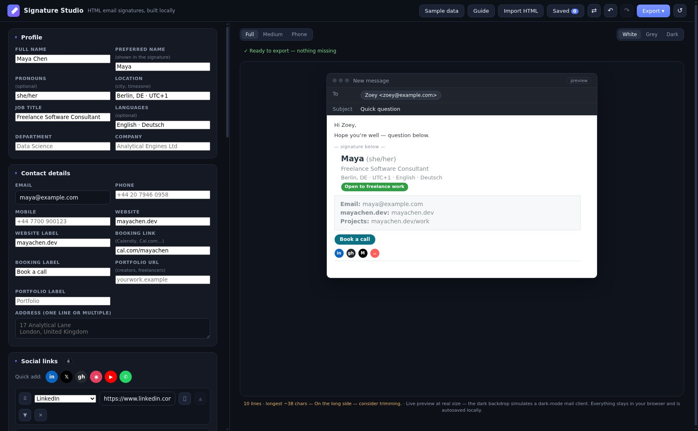
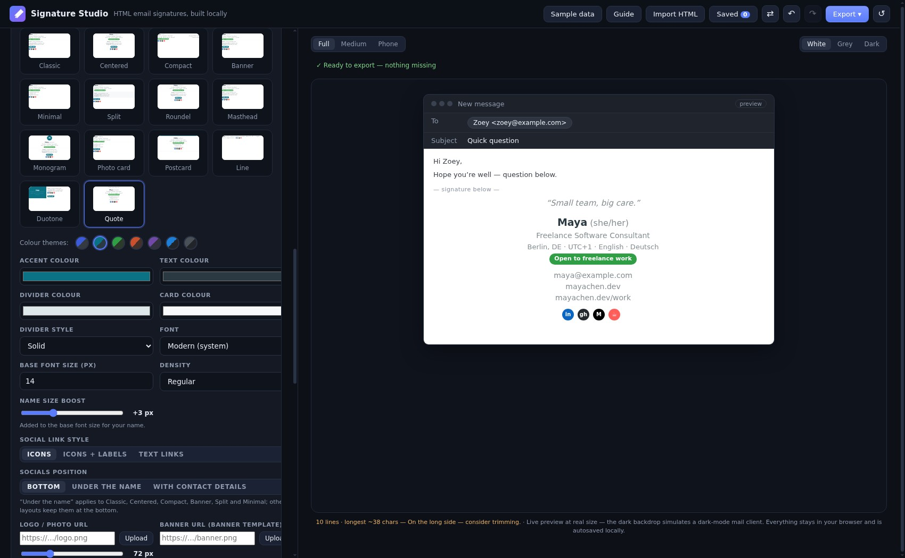
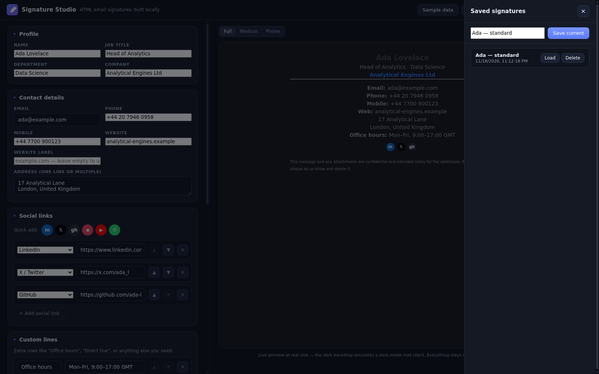
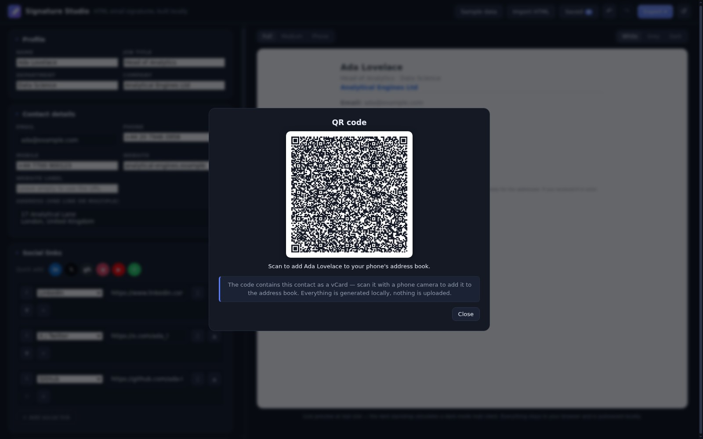

# Signature Studio

> [!IMPORTANT]
> **AI-BUILT DISCLOSURE:** Signature Studio was built largely by an AI coding
> agent. Its code, documentation and release packaging were AI-generated,
> with human direction and testing. Review it independently before relying on
> it for anything sensitive; no warranty of correctness or security is implied.

A web-based tool for **creating and editing HTML email signatures** — in your
browser, with your data staying on your machine. No account, no backend, no
tracking. Works offline.

**Live demo:** <https://diziwizi.github.io/signature-studio/>



## Features

- **14 layout templates** — Classic, Centered, Compact, Banner, Minimal,
  Split, Roundel, Masthead, Monogram, Photo card, Postcard, Line, Duotone,
  Quote — with **live thumbnails**
  in the picker that render your actual signature in each layout as you type.
- **Mobile-friendly by default** — signatures use a fluid width (shrink to any
  screen instead of clipping) and multi-column layouts stack into a single
  column on phones via a media query that Outlook harmlessly ignores. The
  Phone preview shows exactly what mobile recipients see, and the stacking
  can be switched off per signature.
- **Profile & contact details** — full and preferred name, **honorific and
  post-nominals** (Dr., PhD), **pronouns**,
  **location and languages**, title, department, company, **two emails**,
  phone, mobile, website, **portfolio**, **booking link (Calendly/Cal.com)**,
  **PGP public key** (fingerprint or URL — rendered in the signature and
  embedded in your vCard), multi-line address, and **renameable labels** for
  each contact item ("Direct line" instead of "Phone").
- **Social links** — LinkedIn, X, Facebook, Instagram, GitHub, YouTube,
  TikTok, Mastodon, Bluesky, WhatsApp, Telegram, Signal, Xing, Pinterest, plus
  custom links with your own glyph and colour. Quick-add chips, drag-and-drop
  reordering (keyboard ▲▼ kept), remove. Typing just a username ("janedoe")
  is enough — full URLs are built for you. **Image icons**: paste an icon URL
  per network to use a real logo instead of the glyph chip.
- **Custom lines** — office hours, direct line, anything else you need,
  reorderable by drag or buttons.
- **Design controls** — **one-click colour themes** (7 curated palettes),
  accent/text/divider/card colours, divider style (solid/dashed/dotted), 4
  font stacks, base font size, **density presets** (airy/regular/compact)
  and a **name-size boost**, logo (URL or upload) with width, **position
  (left/right)** and a **round-photo** crop, banner image, divider,
  **status badge**, **card wrapper** (tint + border), **strict mode** that
  renders exactly as Word-engine Outlook will (no rounded corners), legal /
  disclaimer footer, social style (icons / icons + labels / text links),
  contact labels on/off, and an **initials monogram** that replaces the
  logo with a coloured initials circle — no image needed. Imported
  signatures get the logo position guessed from the source HTML.
- **Show / hide anything** — per-element toggles (title, company,
  department, location, each contact item, booking, status, socials)
  across every layout, so a signature can be as minimal as you like.
- **Dark-mode friendly toggle** — adds `prefers-color-scheme` overrides for
  Gmail and Apple Mail dark mode, with a dark preview backdrop to check the
  result.
- **Undo / redo** — toolbar buttons and Ctrl/Cmd+Z, Ctrl+Shift+Z for
  structural changes (add/remove/reorder, template switches, imports, …).
- **Live preview** at real size — full / medium / phone widths, white / grey /
  dark backgrounds.
- **Import existing signatures** — paste HTML you already use; name, contact
  details, links, logo and legal lines are recovered (best-effort).
- **Export** — copy rich HTML to the clipboard, download a `.html` file, plain
  text version for text-only clients, and step-by-step install guides for
  Gmail, Outlook (Windows/Mac), Apple Mail, Thunderbird and other webmail.
- **Brand presets (.json)** — export the whole signature as a JSON preset and
  share it with your team; import to adopt it in one click.
- **vCard + QR code** — download the contact as a `.vcf`, or show a QR code
  people can scan to add you to their phone. Generated locally.
- **Autosave + saved signatures** — your draft persists locally; save named
  snapshots and switch between them.
- **PWA / offline** — installable, and a service worker serves the whole app
  (and your work) with no network.
- **Privacy-first** — everything runs in `localStorage`. Nothing is uploaded.







## The output is built for email clients

Generated signatures use table-based layout with **every style inlined** — no
`<style>` blocks, no classes, no external CSS — so they render consistently in
Outlook desktop (Word engine), Gmail, Apple Mail and Thunderbird. Social
"icons" are text glyph chips rather than images by default, so nothing is
blocked and nothing needs hosting. See the [client compatibility
notes](#compatibility) below.

## Quick start

It's a static site — no build step, no dependencies.

**Option A — just open it**

```sh
python3 -m http.server 8137
# open http://localhost:8137
```

(Opening `index.html` directly from disk also works; offline mode and
installability need a real server.)

**Option B — Docker**

```sh
docker compose up --build
# open http://localhost:8080
```

or

```sh
podman build -t signature-studio .
podman run -p 8080:80 signature-studio
```

**Option C — any static host** (nginx, Caddy, Forgejo Pages, …) — publish
only the app itself: `index.html`, `assets/`, `sw.js`, `manifest.webmanifest`.
Do **not** point a public web root at a checkout: `e2e/`, `docs/`,
`test-results/` and `node_modules/` are development material.

The Docker image is built from an explicit allow-list, so it contains the app
and nothing else — `curl localhost:8080/e2e/a11y.spec.js` is a 404.

### Hardening

`nginx.conf` ships the headers this app actually needs:

| Header | Value | Why |
| --- | --- | --- |
| `Content-Security-Policy` | `default-src 'self'; script-src 'self' 'unsafe-inline'; style-src 'self' 'unsafe-inline'; img-src 'self' data: https:; object-src 'none'; frame-ancestors 'none'` | The editor sets inline style attributes, and the live preview injects a tiny click-reporter into an `about:srcdoc` frame. Without those two `'unsafe-inline'` tokens the app renders but click-to-edit silently dies — see `e2e/selfhost.spec.js`, which applies this exact policy and asserts zero violations. |
| `X-Frame-Options` | `DENY` | Nothing may frame the editor. |
| `X-Content-Type-Options` | `nosniff` | |
| `Referrer-Policy` | `no-referrer` | |
| `Permissions-Policy` | `camera=(), microphone=(), geolocation=(), payment=()` | |

Tightening further: replacing the style `'unsafe-inline'` requires moving
every dynamic style attribute into hashed `<style>` blocks, and the script
token is needed for the preview reporter. Neither is worth it for a
single-page local tool; if you do it, delete the corresponding test so the
suite documents the new contract.

`nginx.conf` also returns 404 for `/e2e/`, `/docs/`, `/tools/`, `/tests/`,
`/test-results/`, `/.forgejo/` and any dotfile, so a bind-mounted checkout
does not become a directory listing.

## Using the app

1. **Build** your signature in the left panel — or click *Sample data* to see
   it filled in.
2. Watch the **live preview** on the right; the template picker thumbnails
   show every layout with your data. Use the width and background toggles to
   sanity-check it.
3. **Export ▸ Copy to clipboard**, then paste into your mail client (the
   *Install in your mail client…* guide covers Gmail, Outlook, Apple Mail and
   Thunderbird step by step).
4. Save named variants in the **Saved** panel, share a **preset (.json)** with
   colleagues, or hand out your **vCard / QR code**.

### Images

Use hosted image URLs (your website, a CDN) for logo/banner. Uploading embeds
the image as a data URI, which many mail clients strip — the app warns you
about this.

## Compatibility

| Client | Support | Notes |
| --- | --- | --- |
| Outlook for Windows (desktop) | ✅ built for it | Table layout + inline styles; paste with "Keep Source Formatting" |
| Outlook for Mac / Outlook web | ✅ | |
| Gmail (web + mobile) | ✅ | Optional dark-mode toggle for dark theme |
| Apple Mail (macOS / iOS) | ✅ | Dark-mode toggle recommended |
| Thunderbird | ✅ | Use HTML signature mode |
| Other rich-text webmail (Proton, Fastmail, …) | ✅ | |

Keep signatures ≤ 600 px wide, prefer hosted images, and send yourself a test
email in the client your recipients actually use.

## Project layout

```
index.html              app shell (editor, preview, modals)
assets/styles.css       app UI — never part of generated output
assets/js/state.js      data model, defaults, sample data
assets/js/socials.js    network catalogue (glyph, colour, URL prefix)
assets/js/templates.js  signature renderer: state → HTML document (9 layouts)
assets/js/import.js     best-effort HTML signature importer
assets/js/export.js     clipboard / download / plain-text export
assets/js/storage.js    localStorage draft + saved snapshots
assets/js/vcard.js      vCard 3.0 builder
assets/js/qrcode.js     vendored QR encoder (Kazuhiko Arase, MIT)
assets/js/app.js        UI wiring (history, drag-drop, presets, thumbs, …)
sw.js + manifest.webmanifest   PWA: offline cache + install
assets/icons/           PWA icons
tools/publish_release.py  idempotent Forgejo release publisher
Dockerfile / docker-compose.yml / nginx.conf   self-hosting
.forgejo/workflows/release.yml   syntax checks, smoke test, tag releases
docs/                   design notes, QA report, screenshots, roadmap
```

## Development

```sh
npm run serve       # or: python3 -m http.server 8137
npm run check       # syntax-check all JS + publish script
npm run test:e2e    # Playwright suite (29 tests: boot, templates, socials,
                    # checklist, crop, fixtures, export, undo, preset, PWA…)
                    # first run: npm install && npx playwright install chromium
```

The service worker is **cache-first**: after you change any file, bump
`VERSION` in `sw.js` (or unregister the SW in devtools) or the browser keeps
serving the old copy.

CI (Forgejo Actions) runs the checks and a static smoke test on every push to
`main`, followed by the full Playwright E2E suite; pushes of `v*` tags
additionally build source archives and publish them as a release when the
`RELEASE_TOKEN` repo secret is set.

## Privacy

The app is 100% client-side. Drafts and saved signatures live in your
browser's `localStorage`; nothing is sent anywhere. Clear your site data to
wipe everything.

## Accessibility

Keyboard-complete: modal dialogs trap and restore focus, every control is
tab-reachable (switches and segmented buttons work with Space), icon
buttons are labelled for screen readers, toasts announce via
`role=status`, a skip-to-content link opens the page, focus is always
visible, and `prefers-reduced-motion` disables the animations.

## Roadmap

See [docs/roadmap.md](docs/roadmap.md). A separate
[personal-signatures roadmap](docs/personal-signatures-roadmap.md) collects
recommendations focused on individual (non-corporate) users.

## License

MIT — see [LICENSE](LICENSE). The QR encoder in `assets/js/qrcode.js` is
Copyright (c) 2009 Kazuhiko Arase, MIT — see its header.
